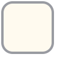

<h3>Three in a row. I win.</h3>

   
   
  

Don't take it badly: whichever square you picked, I had an answer ready.

<a href="new.md">↺ New game</a> &nbsp;·&nbsp; <a href="o________-0.md">This time I start</a> &nbsp;·&nbsp; <a href="https://github.com/1vcian#beat-me-at-tic-tac-toe">← Back to my profile</a>

