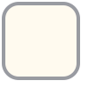

<h3>Three in a row. I win.</h3>

   
   
  

Don't take it badly: nobody has beaten me yet.

<a href="new.md">New game</a> &nbsp;·&nbsp; <a href="o________-0.md">This time I start</a> &nbsp;·&nbsp; <a href="https://github.com/1vcian#tic-tac-toe">Back to my profile</a>

