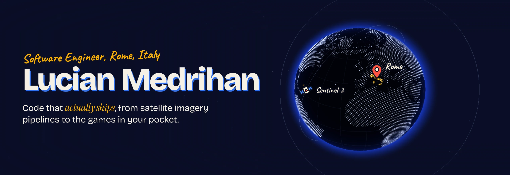
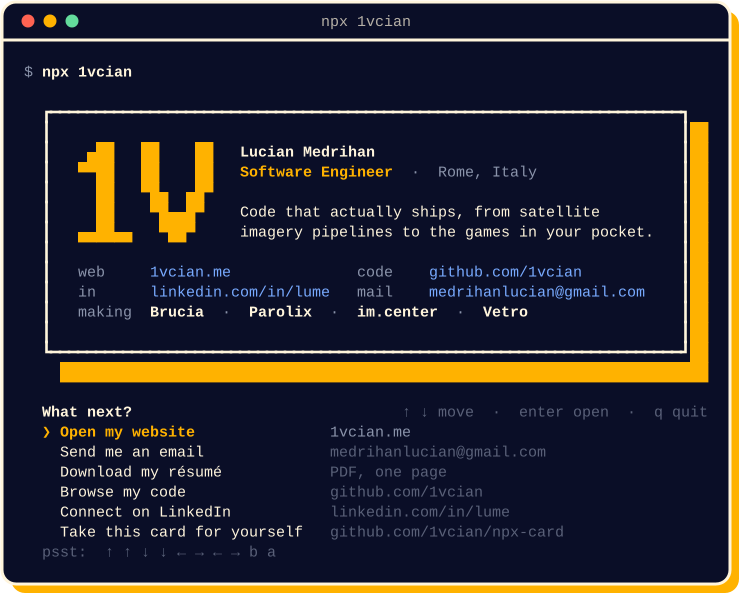

<div align="center">

<a href="https://1vcian.me"></a>

<br>

**[1vcian.me](https://1vcian.me)** &nbsp;·&nbsp; **[LinkedIn](https://linkedin.com/in/lume)** &nbsp;·&nbsp; **[Email](mailto:medrihanlucian@gmail.com)** &nbsp;·&nbsp; **[Résumé](https://1vcian.me/Portfolio/resume.pdf)** &nbsp;·&nbsp; **[`npx 1vcian`](https://github.com/1vcian/npx-card)**

<a href="https://im.center/1vcian"></a>

</div>

## Hi, I'm Lucian

A software engineer in Rome. For 5+ years I have been building production systems for public institutions: GIS platforms, and machine-learning work on satellite imagery and LLMs, on projects for the Italian Ministry of Agriculture and ESA.

The rest of my time goes where the fun is. I hunt vulnerabilities, ship games to the stores and build open-source tools that grew their own communities. Even an emulator.

## What I'm making

| Project | What it is | Where |
| :-- | :-- | :-- |
| **Brucia** | A €50 board and the phone in your pocket, turned into a full kit for authorized security research. | [site](https://1vcian.me/Brucia/) · [code](https://github.com/1vcian/Brucia) |
| **Parolix** | A vintage-newspaper word puzzle in 17 languages, with a backend built to cost next to nothing. | [site](https://1vcian.me/parolix/) · [App Store](https://apps.apple.com/app/id6789910035) · [Google Play](https://play.google.com/store/apps/details?id=app.parolix.lucian) |
| **im.center** | A link-in-bio page that is also a game: every profile sits on a public leaderboard. | [im.center](https://im.center/) |
| **Wolf & Mafia** | A 100% offline social deduction game: 36 roles and a fully guided narrator. | [site](https://wolfmafia.app/) · [App Store](https://apps.apple.com/us/app/wolf-mafia/id6756895478) · [Google Play](https://play.google.com/store/apps/details?id=app.wolfmafia.lucian) |
| **Forge Master Calculator & Wiki**  | The companion the Forge Master community plans its builds with: simulate battles, compare setups, look up anything. | [site](https://1vcian.me/fm) · [code](https://github.com/1vcian/fm) |
| **Card Scanner**  | Card recognition for Pokémon TCG Pocket that runs in the browser in under 10 MB and handles every new set with no retraining. | [demo](https://1vcian.github.io/Pokemon-TCGP-Card-Scanner/) · [code](https://github.com/1vcian/Pokemon-TCGP-Card-Scanner) |
| **EGNSS Capacitor** | One JavaScript API for Galileo OSNMA and EGNOS on Android, iOS and the web: where you are, and how far you can trust it. | [site](https://1vcian.me/egnss-capacitor/) · [code](https://github.com/1vcian/egnss-capacitor) |
| **Vetro** | Work in progress: a complete ARM64 Android system emulated inside a browser tab. | [site](https://1vcian.me/Vetro/) · [code](https://github.com/1vcian/Vetro) |

The full story, with a planet you can spin, is at **[1vcian.me](https://1vcian.me)**.

## Off the clock

- **Bug hunting.** I hunt bugs because I enjoy it: a lot of vulnerabilities found and reported, several of them rated CVSS 10.
- **[Hackappatoi](https://hackappatoi.github.io/).** Sapienza's ethical hacking team, which I co-founded: reverse engineering, web exploitation and forensics in international CTFs.
- **Google Workshop.** Winner with UniverCity, presented at Google Tel Aviv.

## Toolbox

<p>
  <br>
  
</p>

**Day to day:** Python, FastAPI, Flask, Node.js, React, Angular, TypeScript, OpenLayers, GeoPandas.
**Infrastructure & AI:** AWS, Google Cloud Vertex AI, Docker, Linux, LLM agents, image segmentation.
**In side projects:** Kotlin + Compose, Rust → WebAssembly, C++ on ESP32, Capacitor, Firebase, GitHub Actions.

## My card fits in a terminal

```sh
npx 1vcian
```

<a href="https://github.com/1vcian/npx-card"></a>

No dependencies, [open source](https://github.com/1vcian/npx-card) so you can make your own, and there is a game hidden in it.
